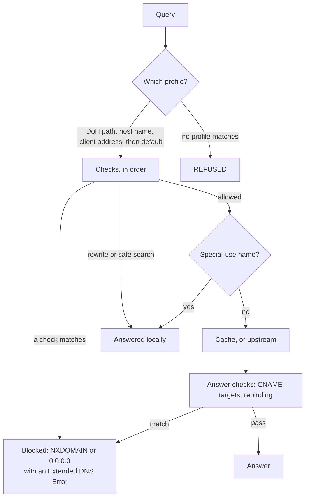

# Profiles and protections

`doh serve` applies a **policy** to every query: a set of **profiles**, each the rules for a group of devices. A profile chooses which protections are on, which blocklists apply, which domains are always allowed or denied, and how blocked names are answered. Every decision can be traced, logged, and undone.

- [How a query is decided](#how-a-query-is-decided)
- [Protections](#protections)
- [Blocklists](#blocklists)
- [Apps and schedules](#apps-and-schedules)
- [Profiles and devices](#profiles-and-devices)
- [The policy file](#the-policy-file)
- [Local names and forward zones](#local-names-and-forward-zones)
- [Query log](#query-log)
- [Admin API and web UI](#admin-api-and-web-ui)
- [Reliability](#reliability)
- [Sharing a server](#sharing-a-server)
- [Following another server's policy](#following-another-servers-policy)
- [Troubleshooting](#troubleshooting)
- [Limits](#limits)

## How a query is decided



The first check that matches decides. `doh explain` (or **Explain** in the web UI) shows every step for any name:

```console
$ doh explain xn--pple-43d.com
xn--pple-43d.com A: BLOCK by homograph (xn--pple-43d.com)
  mixed scripts (Cyrillic, Latin) in аpple
  as profile default

Checks:
  ✓ rewrite    no rewrite
  ✓ allow      not on the allow list
  ✓ deny       not on the deny list
  – bypass     bypass protection is off
  ✓ tld        TLD not blocked
  ✓ list       on none of 1 lists (1 loaded)
  ✗ homograph  mixed scripts (Cyrillic, Latin) in аpple

Answer: NXDOMAIN
```

| Order | Check | What it does |
| --- | --- | --- |
| 1 | `upstream` | The server's own upstream hosts are never filtered, so it can't cut itself off. |
| 2 | `rewrite` | The profile's local answers, such as `nas.home.arpa` → `192.168.1.5`. |
| 3 | `allow` | Allowed domains skip **every** other check, including answer checks. |
| 4 | `deny` | Denied domains are always blocked. |
| 5 | `service` | Blocked apps and sites, such as TikTok. |
| 6 | `schedule` | Schedules in effect now. |
| 7 | `bypass` | Firefox's DoH canary; with bypass protection, Private Relay and public encrypted DNS. |
| 8 | `tld` | Blocked top-level domains. |
| 9 | `list` | Blocklists, unless any of the profile's lists has an exception for the name. |
| 10 | `homograph` | Look-alike internationalized names. |
| 11 | `tunneling` | Data smuggled through DNS. |
| 12 | `newly-registered` | Domains registered recently. |
| 13 | `safe-search` | Safe search hosts for search engines and YouTube. |
| 14 | `cname` | Answers whose CNAME targets are denied, under a blocked TLD, or on a blocklist. |
| 15 | `rebinding` | Answers that point public names at local addresses. |

Blocked names get `NXDOMAIN` (or, with `block_response: "null"`, `0.0.0.0` and `::`), a synthetic SOA so they're cached for only a minute, and an [Extended DNS Error](https://www.rfc-editor.org/rfc/rfc8914.html#section-4.16) naming the reason, such as `blocked: rebinding` or `blocked by threat-intel`.

## Protections

New policies turn on the protections that don't cause false positives on typical networks, and the threat intelligence list.

| Protection | Field | Default | How it works |
| --- | --- | --- | --- |
| DNS rebinding | `security.rebinding` | on | Blocks answers that point a public name at a loopback, [RFC 1918](https://www.rfc-editor.org/rfc/rfc1918.html), unique local, link-local (including cloud metadata at `169.254.169.254`), or unspecified address. IPv4 addresses inside IPv4-mapped and [NAT64](https://www.rfc-editor.org/rfc/rfc6052.html) addresses, and the address hints of [HTTPS records](https://www.rfc-editor.org/rfc/rfc9460.html#section-7.3), are checked too. Local names and forward zones are exempt. Shared address space (`100.64.0.0/10`, used by Tailscale and carrier-grade NAT) is allowed. |
| Look-alike domains | `security.homograph` | on | Decodes [Punycode](https://www.rfc-editor.org/rfc/rfc3492.html) labels and blocks names that mix scripts beyond what [UTS #39's Highly Restrictive level](https://www.unicode.org/reports/tr39/#Restriction_Level_Detection) allows (`аpple.com` with a Cyrillic `а`), are spelled entirely in Cyrillic or Greek letters that look Latin (`аррӏе.com`) outside TLDs where those scripts are expected, contain invisible characters, use deceptive Latin letters such as `ɡ`, or aren't valid IDNA. Plain ASCII names are never affected. |
| Newly registered domains | `security.newly_registered`, `security.newly_registered_days` | off | Looks up each registered domain's creation date with [RDAP](https://www.rfc-editor.org/rfc/rfc9083.html#section-4.5), finding the registry through [IANA's bootstrap](https://www.rfc-editor.org/rfc/rfc9224.html), and blocks domains younger than 30 days (or your threshold). Lookups are cached (on disk, in the data directory) and shared by concurrent queries; if a lookup fails or the TLD has no RDAP service, the name is allowed. |
| DNS tunneling | `security.tunneling` | off | Blocks `NULL` queries, labels of 52 or more characters, labels of 30 or more characters with the randomness of encoded data (≥ 4.2 bits per character, above any hex hash), and, per client, a domain after 100 unique names under it in a minute, for 10 minutes. |
| Bypass methods | `security.bypass` | off | Answers [iCloud Private Relay's canaries](https://developer.apple.com/support/prepare-your-network-for-icloud-private-relay/) negatively and blocks well-known public encrypted DNS services (except your upstreams). For broader coverage, add the `bypass-services` list. |
| Safe search | `safe_search` | off | Answers Google, Bing, DuckDuckGo, and Pixabay with their safe search hosts, and YouTube with restricted mode, as each provider documents. Applies to every record type, so HTTPS records can't route around it. |

[Firefox's canary domain](https://support.mozilla.org/kb/canary-domain-use-application-dnsnet) gets `NXDOMAIN` in every profile that blocks anything, so Firefox keeps using this resolver instead of enabling its own DoH.

Every check also runs on **CNAME targets** in answers, against the profile's deny list, blocked TLDs, and blocklists. This uncovers trackers cloaked behind a first-party name, such as `metrics.shop.example CNAME collect.tracker.example`.

## Blocklists

Profiles list blocklists by preset name, URL, or file path, optionally named as `name=location`. Each list is downloaded once, however many profiles use it, cached on disk, revalidated with conditional requests, and refreshed daily (`--blocklist-refresh`). Lists a profile adds load in the background; until they do, they block nothing, and `doh status` shows them loading.

| Category | Presets |
| --- | --- |
| Security | `threat-intel` (default), `threat-intel-full`, `scams`, `abused-tlds`, `dynamic-dns`, `bypass-services` |
| Privacy | `hagezi-light`, `hagezi-normal` (`default`), `hagezi-pro`, `oisd-small`, `oisd-big`, `stevenblack`, `easylist`, `easyprivacy` |
| Parental | `gambling`, `adult`, `social` |

`doh blocklist presets` describes each one. `--blocklist`, `--block-domain`, `--allow-domain`, and `--block-response` apply to **every** profile, as a baseline; a profile's allow list overrides baseline blocks.

## Apps and schedules

Profiles can block apps and sites by name, always or on a schedule.

**Services** block an app's domains with one setting. The catalog covers 93 apps across social, messaging, video and streaming, music, gaming, AI chat, shopping, dating, and gambling and betting; `doh services` lists them, `doh services chat` searches, and the web UI's Apps section has the same search. Each lists only domains the service owns, never shared ones such as `googleapis.com`, and each domain belongs to one service, so blocking one doesn't break another: Messenger is its own service, separate from Facebook. Where a service lives on part of a large company's domain, only that part is listed, so `gemini` blocks `gemini.google.com` but not the rest of Google. CNAME targets are checked too, so an app can't slip through behind another name. Apps change their domains, though, so a blocked service is a strong default, not a guarantee; add domains to deny alongside it if something gets through. Whole categories of sites, beyond the apps listed, are better blocked with the `social`, `gambling`, and `adult` lists.

**Schedules** block more during a recurring period, in the profile's `time_zone` (an IANA name such as `America/New_York`; the server's own by default):

```json
{
  "id": "kids",
  "time_zone": "America/New_York",
  "services": ["tiktok"],
  "schedules": [
    { "name": "Homework", "days": ["mon", "tue", "wed", "thu", "fri"], "start": "15:00", "end": "18:00",
      "services": ["youtube", "roblox"], "lists": ["social"] },
    { "name": "Bedtime", "days": ["sun", "mon", "tue", "wed", "thu"], "start": "21:00", "end": "07:00",
      "block_all": true, "allow": ["school.example"] }
  ]
}
```

A period that ends before it starts runs past midnight and belongs to the day it starts on: Thursday's bedtime lasts into Friday morning, and Friday night has none. One that ends when it starts, such as `00:00` to `00:00`, lasts all day on its days. During a period, the schedule's services, lists, and denied domains are blocked; with `block_all`, everything is, except the profile's allowed domains, the schedule's `allow`, and names local to the network, such as the router and printer. Blocked queries are logged with reason `schedule` and the schedule's name, and the block says until when, as in "Homework: YouTube is blocked until 18:00", or "today" for an all-day one. That sentence is the log entry's `detail`, shown as "Why" in the web UI.

## Profiles and devices

A query is matched to a profile by, in order:

1. **The DoH path.** `https://doh.example.com/dns-query/kids` uses profile `kids`; `/dns-query/kids/tablet` also names the device `tablet` in the log. Unknown profiles get `404`. Profile IDs are identifiers, not secrets: anyone who knows one can use that profile.
2. **The host name**, with `--hostname dns.example.com` (or an ACME domain): over DoT, the TLS server name, and over DoH, the host. `kids.dns.example.com` selects profile `kids`, and `tablet--kids.dns.example.com` also names the device. Names under the hostname that name no profile are refused, rather than falling back to another profile. `doh setup` prints the right settings for each platform.
3. **The client's address**, against every profile's `clients` (addresses or prefixes) and `devices`. The most specific prefix wins, so a device listed by address overrides the network it's on. Behind a reverse proxy, set `--trusted-proxy` so `X-Forwarded-For` names the client; it's ignored from anyone else.
4. **The `default` profile.** Remove it to make the server **closed**: queries from unmatched clients get `REFUSED` with an Extended DNS Error, which keeps a server on the internet from being an open resolver.

```console
$ doh profile create streaming --name "Streaming sticks"
$ doh profile set streaming clients=192.168.1.40/29 security.newly_registered=true security.bypass=true
$ doh allow some-new-streaming-cdn.example --profile streaming
$ doh profile set kids safe_search=true lists=threat-intel,adult,gambling
```

`doh profile set` turns `key=value` pairs into a [JSON merge patch](https://www.rfc-editor.org/rfc/rfc7396.html). An empty value (`key=`) resets a field.

## The policy file

Profiles live in `policy.json` in the data directory (`--data-dir`: `$STATE_DIRECTORY` under systemd, otherwise `doh` in your configuration directory). It's created with the defaults on first run, readable only by its owner, and reloaded within seconds of being edited by hand. An invalid edit is logged and ignored, keeping the current policy. A server won't start with an invalid policy file.

```json
{
  "version": 1,
  "profiles": [
    {
      "id": "default",
      "name": "Default",
      "security": { "rebinding": true, "homograph": true, "newly_registered": false, "tunneling": false, "bypass": false },
      "lists": ["threat-intel"],
      "rewrites": [{ "name": "nas.home.arpa", "addrs": ["192.168.1.5"] }],
      "safe_search": false
    },
    {
      "id": "streaming",
      "name": "Streaming sticks",
      "devices": [{ "name": "living-room-tv", "addrs": ["192.168.1.50"] }],
      "security": { "rebinding": true, "homograph": true, "newly_registered": true, "newly_registered_days": 14, "tunneling": false, "bypass": true },
      "lists": ["threat-intel", "hagezi-normal"],
      "allow": ["gef.sh"],
      "safe_search": false
    }
  ]
}
```

Unknown fields, duplicate keys, and every invalid value are rejected, with each problem listed, so a policy that loads is a policy that applies. `--policy off` turns profiles off, leaving only the baseline blocklist flags.

## Local names and forward zones

Some names mean nothing on the public internet, so the server answers them itself rather than leaking them upstream:

| Names | Answer | Why |
| --- | --- | --- |
| `localhost` and its subdomains | `127.0.0.1` and `::1` | [RFC 6761, Section 6.3](https://www.rfc-editor.org/rfc/rfc6761.html#section-6.3) |
| `invalid`, `local` | `NXDOMAIN` | [RFC 6761](https://www.rfc-editor.org/rfc/rfc6761.html#section-6.4), [RFC 6762](https://www.rfc-editor.org/rfc/rfc6762.html#section-3) |
| `home.arpa` | `NXDOMAIN` | [RFC 8375](https://www.rfc-editor.org/rfc/rfc8375.html#section-4) |
| `resolver.arpa` | no records | Forwarding it would let clients discover the upstream's encrypted resolver and bypass this one ([RFC 9462, Section 6.5](https://www.rfc-editor.org/rfc/rfc9462.html#section-6.5)). |
| Reverse lookups of private, loopback, link-local, documentation, and shared addresses | `NXDOMAIN` | [RFC 6303](https://www.rfc-editor.org/rfc/rfc6303.html#section-4), [RFC 7793](https://www.rfc-editor.org/rfc/rfc7793.html) |

To resolve your network's own names, forward their domains to the resolver that knows them, usually the router. Forwarded domains count as local, so their answers may point to private addresses:

```console
$ doh serve --dns-listen :53 --forward lan=192.168.1.1 --forward 168.192.in-addr.arpa=192.168.1.1
```

Or answer a name yourself with a profile rewrite, as `nas.home.arpa` in the example above.

### Device names

The query log names devices without anyone typing names in: it learns what each device on the local network calls itself, and shows `living-room-tv` rather than `192.168.1.50`. Names come from, in order:

1. DHCP lease files, with `--dhcp-leases`, when doh runs beside the DHCP server: dnsmasq's (as on OpenWrt and Pi-hole), or Kea's CSV files.
2. Reverse lookups through forward zones that cover the device's address, such as `--forward 168.192.in-addr.arpa=192.168.1.1`: most home routers answer them with their DHCP clients' hostnames.
3. Reverse lookups to `--device-names-from`, or with none set, to the default gateway (on Linux).

Names are looked up in the background, only for private, unique local, and link-local addresses, and cached for an hour, so answering never waits on them: a new device is named from its next query on. Stats count each device once, however its name was known.

Devices choose their own hostnames, so a name like `kids-tablet` proves nothing. Learned names are shown as a device's `hostname`, apart from the device names you configure, and never select a profile or affect any other decision. `--no-device-names` turns them off.

## Query log

Every query is logged with its profile, device, client, name, type, outcome, reason, matching rule and list, answers, upstream, and duration. The newest 50,000 entries are kept in memory to search, and every entry is written to a daily file in `querylog/` in the data directory, which is reloaded on restart and deleted after `--query-log-retention` (seven days by default). Turn logging off for a profile with `"logging": {"disabled": true}`, or for the whole server with `--no-query-log`; queries are still counted in metrics.

```console
$ doh log --blocked -n 5
TIME      CLIENT          STATUS   TYPE  NAME                      REASON
18:53:08  living-room-tv  blocked  A     ads.example.net           list (hagezi-normal)
$ doh log -f --profile kids         # follow live
$ doh log --json -q google | jq .   # JSON lines
```

## Admin API and web UI

With `--admin-listen`, the admin listener serves a web UI at `/` and a JSON API at `/api/v1`, alongside metrics and profiling. The UI toggles every protection and list, edits allow and deny lists, devices, and rewrites, connects devices, searches and follows the query log, allows or blocks a name from any log entry in one click, and explains any decision.

### Signing in

Browsers never hold an API token. Instead:

```console
$ doh serve --dns-listen :53 --admin-listen localhost:9090
$ doh ui
http://localhost:9090/#signin=…
```

`doh ui` creates a **sign-in link** through the API: single-use, valid for five minutes, with its code in the URL fragment, which browsers never send to servers, so it stays out of logs. Opening it gives the browser a session cookie that scripts can't read (`HttpOnly`), that other sites can't send (`SameSite=Strict`), and that's `Secure` and host-only (`__Host-`) over HTTPS. Sessions end after two hours unused, or twelve hours at most.

Signed in, add a **passkey** ([WebAuthn](https://www.w3.org/TR/webauthn-3/)): Face ID, Touch ID, Windows Hello, a phone, or a security key. From then on:

- A passkey signs in on its own. It needs your device and its biometric or PIN, and can't be phished: it only works at the UI's own origin.
- A sign-in link becomes a first factor only: it starts a sign-in that a passkey must finish. A leaked link, or a stolen token that makes them, isn't enough.

Passkeys are verified by a native WebAuthn relying party ([`internal/webauthn`](../internal/webauthn)), with single-use challenges bound to the browser's session, user verification required, and every response bounded. People and their passkeys are kept in `people.json` in the data directory. Sign-in attempts are rate limited per client, and sessions that haven't finished signing in can't crowd out those that have.

If everyone loses their passkeys, an operator with the admin token removes them (`doh people remove`), and sign-in links work on their own again.

Passkeys need the UI opened at a host name: on a loopback admin listener that's `http://localhost:{port}`, where page loads at `127.0.0.1` are redirected. Elsewhere, put the admin listener behind a TLS-terminating proxy and set `--admin-origin https://admin.dns.example.com`. Without an origin, browser sign-in is off, and only API tokens work.

### API tokens

On first run the server generates two tokens in the data directory: `admin.token` for everything, and `reader.token` for read-only access (`GET` requests), for the CLI, automation, and following another server's policy. Requests send `Authorization: Bearer <token>`. Browsers' state-changing requests from other origins are refused, whatever they carry.

The API is documented in [`internal/api`](../internal/api/api.go). Policy changes are conditional on the `ETag` with `If-Match`, so two people editing at once can't overwrite each other's changes (`412 Precondition Failed`). Profiles are changed with JSON merge patches.

The client commands (`doh status`, `profile`, `allow`, `deny`, `log`, `explain`, `setup`, `people`, `ui`) read `DOH_ADDR` (default `http://127.0.0.1:9090`), and `DOH_TOKEN` or `DOH_TOKEN_FILE` (default: the admin token in the default data directory). They refuse to send a token over plain HTTP to anything but a loopback address.

> [!WARNING]
> The admin listener also serves metrics and profiling. On a loopback listener that isn't published with `--admin-origin`, profiling stays open to the machine's own users, so `go tool pprof` works; once published, `/debug` needs the operator's credentials. Metrics stay open for scrapers. Treat both tokens as secrets.

## Reliability

DNS failing is the network failing, so the server tries hard not to:

- **Upstreams answer in a race, not a queue.** They're asked in order of preference, but if one hasn't answered after 300 milliseconds, or fails, the next is asked too, and the first answer wins ([RFC 8305](https://www.rfc-editor.org/rfc/rfc8305.html) style). An upstream that fails twice in a row is asked last, with a backoff from five seconds to five minutes, until it answers again. `doh status` shows each upstream's health.
- **Stale answers beat no answers.** If every upstream fails, names resolved in the last day are answered from the cache ([RFC 8767](https://www.rfc-editor.org/rfc/rfc8767.html)), with a 30-second TTL so clients come back soon, and an [Extended DNS Error](https://www.rfc-editor.org/rfc/rfc8914.html#section-4.4) saying so. They're logged with reason `stale`, and counted in `doh_stale_answers_total`.
- **Lists and policies keep working offline.** Blocklists are cached on disk and kept if a refresh fails; a policy followed from another server is cached too.

## Sharing a server

One server can serve several households, each managing its own profiles, devices, query log, and people, without seeing or affecting anyone else's. Each household is a **tenant**; profiles without a tenant belong to the server's **operator**.

```console
$ doh tenant create smiths --name "The Smiths" --network 192.168.10.0/24
$ doh tenant invite smiths
https://admin.dns.example.com/#signin=…
```

The invitation signs in the tenant's first admin. They add a passkey, create profiles, connect devices, and invite others in their household, with `doh ui` style links of their own. What they can't do is bounded by the operator, since their profiles run on someone else's server:

| A tenant's profiles… | Because |
| --- | --- |
| select clients by address only within the tenant's `networks`, which can't overlap other tenants' | Otherwise one tenant could claim `0.0.0.0/0` and capture everyone's plain-DNS clients. Without networks, devices select profiles by DoH path or host name only. |
| use preset blocklists only, unless the operator sets `custom_lists`, which allows HTTPS URLs, never files or plain HTTP | The server downloads lists, so arbitrary locations would let a tenant read the server's files or reach its private network. |
| number at most `max_profiles` (20 by default) | Bounds what one tenant can make the server do. |

Tenants see only their own profiles, query log entries, stats, people, and setup instructions. Everything else, including other tenants' profiles, looks like it doesn't exist. The raw policy, tenant management, server status details (traffic, lists, listeners), and profiling are the operator's alone. API tokens are operator credentials; tenants sign in with links and passkeys. Each tenant's passkey requirement is its own, so a newly invited household can sign in with its first link even when the operator uses passkeys.

Profile IDs and device names share one namespace, since they appear in DoH paths and host names, so a tenant can learn that an ID is taken, though not whose it is.

Removing a tenant (`doh tenant delete`) requires removing or moving its profiles first, and removes its people.

## Following another server's policy

A server can follow another server's policy instead of keeping its own. For example, a Raspberry Pi at home can follow a server in the cloud, so one place manages a family's profiles:

```console
$ doh serve --dns-listen :53 \
    --policy https://doh.example.com:9090/api/v1/policy \
    --policy-token-file /etc/doh/reader.token
```

The follower polls every minute (`policy.refresh` in the config file) with `If-None-Match`, applies each new policy, and caches it in its data directory, so it starts with the last known policy if the other server is down. Its own API is read-only. The URL must use HTTPS unless it's on a loopback address, and redirects aren't followed, so the token can't be sent elsewhere. Use the other server's **reader** token.

Each server keeps its own query log and queries its own upstreams. Without `--policy`, a server is fully independent.

## Troubleshooting

`doh doctor` checks that a device's DNS actually reaches doh:

```console
$ doh doctor
✓ system nameservers: 192.168.1.10
✓ 192.168.1.10:53 is answered by doh (profile=default, device=laptop, client=192.168.1.23)
✓ Firefox will use this network's resolver
✓ admin API reachable at http://127.0.0.1:9090
```

It asks each nameserver who it is with a CHAOS `TXT` query for `id.server` ([RFC 4892](https://www.rfc-editor.org/rfc/rfc4892.html#section-2)). doh answers with the profile and device the query matched, which you can also see with `dig CH TXT id.server @192.168.1.10`.

Common findings:

- **Tailscale MagicDNS is handling DNS** (`100.100.100.100`). While Tailscale runs, it sends the device's queries to MagicDNS first, which can bypass doh. Add doh as a global nameserver with **Override local DNS** in the Tailscale admin console, or run `tailscale set --accept-dns=false` on the device. This is easy to forget, since it applies even when you don't think of Tailscale as running.
- **systemd-resolved's stub resolver** (`127.0.0.53`). It forwards elsewhere; `resolvectl status` shows where.
- **macOS** doesn't always use `/etc/resolv.conf`; `scutil --dns` shows the resolvers it does use, including VPNs'.

## Limits

- Detection is heuristic. Look-alike checks cover internationalized names only, not ASCII typosquats such as `paypa1.com`. Tunneling detection can flag security software that queries hashes over DNS; allow its domains if so.
- Newly registered domain checks depend on registries' RDAP services. Many country-code TLDs (such as `.io`, `.sh`, `.de`, and `.co`) have none, so their names are never blocked as new. Registries see which domains are looked up, though not who asked, and each domain is looked up at most about once a month.
- There's no "newly active" signal: a long-registered domain that has just started resolving isn't detected.
- Blocking works on names. Apps that hard-code IP addresses, or use encrypted DNS services that aren't blocked, aren't filtered; bypass protection and the `bypass-services` list make that harder, not impossible.
- Profile IDs in DoH paths are identifiers, not credentials. To keep strangers off a public server, remove the `default` profile and use unguessable profile IDs, or restrict who can reach it.
- Client addresses identify devices only as well as the network does. Behind NAT, a whole network shares one address; over DoH, use per-device paths instead. Apps on the same device can't be told apart.
